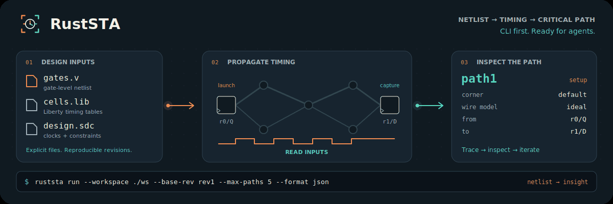

<p align="center">
  
</p>

# RustSTA

**Static timing analysis in Rust. Built for terminals and agents.**

[](https://github.com/lab-emi/RustSTA/actions/workflows/ci.yml)
[](LICENSE)
[](rust-toolchain.toml)
[](https://lab-emi.github.io/RustSTA/)

RustSTA turns gate-level Verilog, Liberty and SDC into timing results you can
trace, check and automate. Analyze multiple corners, inspect critical paths,
query saved results as JSON, and coordinate changes through immutable disk
workspaces. Part of the **RustEDA** family.

<picture>
  <source media="(prefers-reduced-motion: reduce)" srcset="docs/assets/ruststa-banner.svg">
  
</picture>

[Static banner](docs/assets/ruststa-banner.svg) · [Get started](#quick-start) ·
[Agent guide](docs/guide/agents.md) · [Documentation](https://lab-emi.github.io/RustSTA/) ·
[Verification](docs/verification/index.md)

- **Follow the critical path:** multi-corner NLDM timing, setup and hold, latches, recovery/removal, clock gating and explicit timing exceptions.
- **Inspect without another run:** memory-mapped `sta.rbin` reports, path tracing, pin inspection and bounded endpoint queries.
- **Give agents a contract:** JSON results, coded diagnostics, shell-safe handles and fixed exit statuses.
- **Keep changes coordinated:** daemonless disk workspaces, immutable revisions and explicit `--base-rev` conflict checks.
- **Choose how to compute:** deterministic pure Rust CPU propagation in f64; optional native CUDA with CPU differential checks.
- **Keep the evidence:** independent checker and full-rerun modes, analytic fixtures, incremental consistency tests, and pinned Sky130/GF180 libraries.

> **Development preview:** version 0.1.0 is unreleased and is not on crates.io.
> Build from source. Linux is the CI baseline. Read the
> [analysis scope](docs/reference/scope.md) and [verification limits](docs/verification/index.md)
> before interpreting a timing result.

## Quick start

Install [Rust with rustup](https://rustup.rs/) and Git. The checkout pins Rust 1.97.1.
The default build needs no GPU or Python runtime.

```console,lab
$ git clone https://github.com/lab-emi/RustSTA.git
$ cd RustSTA
$ cargo build --locked --release -p rusteda-cli -p ruststa-cli
```

Add the built binaries to your shell path, then confirm the CPU build:

```bash
export PATH="$PWD/target/release:$PATH"
```

```console
$ ruststa --version
ruststa 0.1.0 (backends: cpu)
```

From the repository root, analyze the bundled eight-cell chain in a fresh workspace:

```bash
FIX=verification/fixtures/synthetic/sta
WS=.work/first-timing

rusteda init --workspace "$WS" --format json
rusteda import --workspace "$WS" --base-rev rev0 \
  --lib "$FIX/lib/wt_15.lib" \
  --netlist "$FIX/net/chain_8.v" \
  --sdc "$FIX/sdc/chain_8.sdc" --format json
ruststa run --workspace "$WS" --base-rev rev1 \
  --threads 2 --max-paths 5 --max-state-gib 1 --format json
ruststa report --workspace "$WS" --rev rev2 --section summary --format json
ruststa path --workspace "$WS" --rev rev2 --target path1 --format json
ruststa check --workspace "$WS" --base-rev rev2 --method both --format json
```

The synthetic library is a test fixture. This flow creates `rev0` → `rev1` →
`rev2` → `rev3`; queries read `rev2`, and checking adds `sta_check.json` in `rev3`.
A successful operation, timing closure and a verification verdict are separate
results. Inspect corner, wire model and unconstrained endpoints alongside slack.

The [complete quickstart](docs/guide/quickstart.md) explains reports and artifacts.
For your own design, follow [the timing workflow](docs/guide/timing.md).

## A workspace you can inspect

| Command | Result |
|---|---|
| `rusteda init` / `import` | Create a workspace and import Verilog, Liberty and SDC |
| `ruststa run` / `update` | Analyze a revision and persist `sta.rbin` |
| `ruststa path` / `inspect` / `report` | Read timing paths, pins, endpoints and summaries |
| `ruststa check` | Compare saved timing with an independent checker, a full rerun, or both |
| `rusteda show` / `log` / `diff` / `export` | Inspect revisions and export structural Verilog |

Updates to an existing workspace require an explicit `--base-rev revN`.
A stale revision fails with `REVISION_CONFLICT` (exit 4). Queries accept `--rev`;
handles such as `path1` belong to the selected revision. Initialization creates
`rev0` and takes no base revision.

[Agent integration](docs/guide/agents.md) · [Commands and exit codes](docs/reference/cli.md) ·
[JSON reports and artifacts](docs/reference/reports.md)

## Timing scope

| Available now | Current boundary |
|---|---|
| Multi-corner 1D/2D/3D Liberty NLDM tables | No CCS/ECSM or sign-off accuracy claim |
| Setup/hold, latch borrowing, recovery/removal, gating checks | Ideal clocks; generated/propagated clocks and CPPR are outside current scope |
| Constants and supported `-from`/`-to` timing exceptions | Ordered `-through` exception hops are rejected by the engine |
| Ideal or lumped wire-load models | No SPEF annotation or distributed RC timing |
| CPU f64 and optional CUDA f64/f32 propagation | Metal/Accelerate is not a shipped backend |
| Incremental `TimingSession` Rust API | The CLI `ruststa update` currently reports full recomputation |

Unsupported semantic constructs produce diagnostics. See the
[complete support table](docs/reference/scope.md),
[backend guide](docs/guide/backends.md) and [roadmap](docs/roadmap.md).

## Verification and performance

The test infrastructure includes hand-derived timing cases, a separately
implemented `ruststa-check`, full-vs-incremental consistency checks, and pinned
**SkyWater `sky130_fd_sc_hd`** and **GlobalFoundries
`gf180mcu_fd_sc_mcu7t5v0` / `gf180mcu_fd_sc_mcu9t5v0`** Liberty libraries.

```console,lab
$ cargo xtask pdk fetch
$ cargo xtask verify pdk --profile pr --require
```

Coverage and limits are explicit: the independent checker can return `undecided`
on bounded large exception cases; a missing external tool or device is
unverified. No numerical RustSTA-vs-OpenSTA speedup is claimed by this release.
Compare pinned reference executables as black boxes and report complete command
wall time, peak memory, timing scope and numerical agreement together.

[Verification scope](docs/verification/index.md) · [Dual-PDK suite](docs/verification/pdk.md) ·
[Performance and memory](docs/guide/performance.md)

## Documentation

- [Get started](https://lab-emi.github.io/RustSTA/guide/quickstart/) and [install from source](docs/guide/installation.md).
- [Timing manual](docs/user/sta/README.md), [CLI manual](docs/user/cli/README.md), and [formal specifications](docs/specs/sta/README.md).
- [Architecture](docs/architecture/index.md), [requirements and evidence](docs/verification/requirements.md), and [RustEDA brand](docs/brand/README.md).
- [Build and publish the documentation](docs/about/maintaining-docs.md).

## Contributing

See [CONTRIBUTING.md](CONTRIBUTING.md) for specification-first development,
clean-room boundaries, independent verification and memory budgets.
[Development checks](docs/contributing.md) cover layout, formatting, shared
crates, fixtures and tests. Everyone participating follows the
[Code of Conduct](CODE_OF_CONDUCT.md).

Report vulnerabilities according to [SECURITY.md](SECURITY.md).
RustSTA is licensed under [Apache-2.0](LICENSE); see [NOTICE](NOTICE) and
[REUSE.toml](REUSE.toml).
