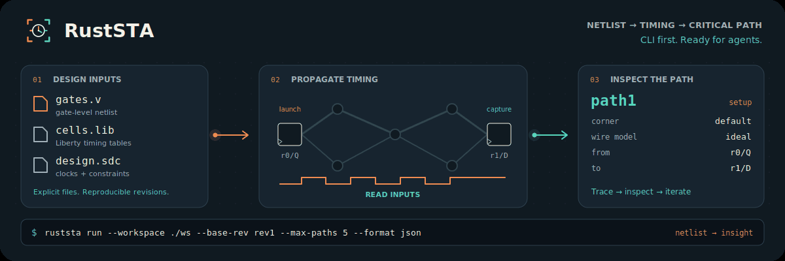

<p align="center">
  
</p>

<h1 align="center">Timing feedback for the next design iteration.</h1>

<p align="center">
  <a href="https://lab-emi.github.io/RustEDA/modules/ruststa/">Documentation</a> ·
  <a href="https://github.com/lab-emi/RustEDA">RustEDA</a> ·
  <a href="https://lab-emi.github.io/RustEDA/benchmarks/">Benchmarks</a> ·
  <a href="LICENSE">Apache-2.0</a>
</p>

<picture>
  <source media="(prefers-reduced-motion: reduce)" srcset="docs/assets/ruststa-banner.svg">
  
</picture>

RustSTA analyzes gate-level Verilog, Liberty, SDC and SPEF with persistent multi-corner timing results, bounded queries and incremental updates.

Part of **[RustEDA](https://github.com/lab-emi/RustEDA)**, infrastructure for chip-design recursive self-improvement. Native tools shorten the work between inference steps; verified results guide the next iteration.

## RustSTA vs OpenSTA at a glance

Ibex RTL-to-GDS on IHP SG13G2 with EZ130 cells and two SRAM macros, 2026-11-13: RustEDA and LibreLane 3.0.17 (OpenROAD, Yosys, KLayout, Magic, Netgen) ran one after the other on the same 4-vCPU host from the same prepared inputs, and the same signoff scripts checked both layouts. Every RustEDA engine was built with Rust 1.100.0, and RustEDA's step graph ran under its Rust executor, `rusteda flow exec`.

- **1.6× faster than OpenSTA at 2 threads and 2.0× at 4** on the final Ibex netlist and SPEF at TT and SS (4.692 s and 3.403 s against 7.349 s and 6.881 s). After the campaign, RustSTA `de210a6` uses **29.5 % less peak memory than OpenSTA at 2 threads and 12.6 % less at 4** (worst 124,120 and 154,144 against 176,172 and 176,308 KiB, in same-load runs with OpenSTA and the campaign's binary), with unchanged speed and byte-identical outputs (in the campaign: 13.6 % less at 2 threads but 11.8 % more at 4, 197,060 against 176,252 KiB).
- All eight compared worst slacks agree with OpenSTA **within 0.270 ps**.
- The flow's static timing takes 26.96 s against 138.93 s for LibreLane's OpenSTA steps (**5.2× faster**), and the native layout is timing-clean where LibreLane's has 112 capacitance and fanout violations.
- The frontend STA and ECO stage, whose ECO rounds and planning helpers are now `rusteda` commands built by this module, takes 13.85 s against 48.36 s for LibreLane's four resizer repair steps (**3.5× faster**); in same-load runs it took a median 13.21 s against 18.20 s for LibreLane's two resizer steps before global routing alone (**0.73×**, ranges do not overlap; 1.18× on 2026-11-05).
- The whole RustEDA flow finishes **4.4× sooner end to end** (751.54 s against 3,283.05 s).

LibreLane's layout fails the shared timing gate (112 maximum-capacitance and fanout violations at TT and SS) and its equivalence check does not complete, so the receipt keeps its own ratio fields null under its publication rule; the multiples here divide the recorded times. Stages are paired by phase, not as identical tasks. Against the three losses of 2026-11-05, in same-load runs: repair before global routing now takes 0.73× the time of LibreLane's two pre-route resizer steps (ranges do not overlap; 1.18× on 2026-11-05), OpenRCX on RustEDA's layout is level with its time on LibreLane's (1.00×, ranges overlap; 1.36× on 2026-11-05) and the latch-up check on RustEDA's layout takes 0.76× its time on LibreLane's (1.11× with the checker of that campaign). RustEDA is still not faster or not better everywhere: the shared timing gate (RustSTA and OpenSTA on each layout's OpenRCX SPEF) is level (0.98×, ranges overlap), RustROAD's standalone extraction took 1.22× OpenRCX's time at 4 threads in the campaign and, after two changes since, is level at 4 threads (0.91×, faster in every run but with overlapping ranges) and 1.64× slower at 2 ([second round](https://lab-emi.github.io/RustEDA/benchmarks/#rustroad-extraction-second-round-2026-11-14)), and the native layout keeps less hold margin. RustSTA's peak memory at 4 threads, 11.8 % above OpenSTA's in the campaign, is 12.6 % below it since a change after the campaign ([details](https://lab-emi.github.io/RustEDA/benchmarks/#ruststa-peak-memory-and-rustroad-extraction-2026-11-13)). [All stages, gates and losses](https://lab-emi.github.io/RustEDA/benchmarks/#ibex-host-campaign-2026-11-13)

## PULPissimo benchmark scope

RustEDA's [PULPissimo benchmark](https://lab-emi.github.io/RustEDA/benchmarks/pulpissimo/) is **synthesis-only** and does not time RustSTA. It compares the PULPissimo Ibex core with a bounded Yosys 0.70/ABC reference on SKY130 HD; there is no extracted SPEF, constraint run or timing result in that campaign. On SKY130 the full PULPissimo SoC still exceeds a 2 h synthesis budget with behavioral L2 memory; an IHP SG13G2 / EZ130 synthesis-only test with 80 official SRAM macros completes in 426 s. Neither is a physical signoff result. RustSTA's timing claims remain the Ibex RTL-to-GDS head-to-head below.

## Peak memory below OpenSTA · 2026-11-13

After the 2026-11-13 host campaign, RustSTA commit
[`de210a6`](https://github.com/lab-emi/RustSTA/commit/de210a66e5cef12e9e0cb11eec8a2e11ee77f0ba)
brought the peak memory of the Ibex timing section below OpenSTA's at both
thread counts, with unchanged speed and byte-identical outputs. In same-load
runs with OpenSTA and the campaign's binary, **its worst peak RSS was
154,144 KiB against OpenSTA's 176,308 KiB at 4 threads (12.6 % less)**, where
the campaign's binary used 194,124 KiB (10.1 % more) in the same runs, and
**124,120 against 176,172 KiB at 2 threads (29.5 % less)**. Its wall and CPU
ranges overlap with the campaign binary's, so its speed is unchanged: 1.94×
faster than OpenSTA at 4 threads and 1.56× at 2 in these runs.

**What changed and why.** The extra memory was memory that glibc's allocator
kept resident after it was freed, not live data: the live heap peaks at about
135 MiB at 4 threads, and the resident peak was 30 to 54 MiB above it, by a
different amount in every run. glibc raises its mmap threshold to the size of
each large block that is freed (up to 32 MiB), after which large blocks come
from the arena of the allocating thread, and an arena gives freed pages back
only from its top. Each worker thread has its own arena, so the parsed SPEF
(freed once both corners are bound) and each corner's preparation stayed
resident while later phases allocated in other arenas. The one analysis change
between the 2026-11-05 and 2026-11-13 campaigns,
[`c55e325`](https://github.com/lab-emi/RustSTA/commit/c55e3256a8edf1692c746b54f03ccc365fb76f18),
added about 13 MiB of such kept pages at 4 threads and no live heap; the
toolchain and the new layout show no consistent effect. The `ruststa` program
now fixes the threshold at 1 MiB, unless `MALLOC_MMAP_THRESHOLD_` or
`GLIBC_TUNABLES` already sets it, and returns the allocator's free pages at the
end of every analysis phase, which costs about 15 ms per run. The resident peak
is now the live peak plus about 10 MiB of mapped program.

| Same-load A/B, 7 runs after a warm-up, interleaved | Campaign binary | New binary | Competitor |
| --- | ---: | ---: | ---: |
| **Timing section** (init, import, run, 8 reports; wall time summed) | RustSTA `d453782` | RustSTA `de210a6` | OpenSTA 3.1.0, TT + SS |
| Worst peak RSS, 4 threads | 194,124 KiB | **154,144 KiB** | 176,308 KiB |
| Median peak RSS, 4 threads (range) | 192,680 (177,756–194,124) KiB | **149,448 (148,832–154,144) KiB** | 176,004 (175,780–176,308) KiB |
| Worst peak RSS, 2 threads | 165,156 KiB | **124,120 KiB** | 176,172 KiB |
| Median peak RSS, 2 threads (range) | 154,796 (148,764–165,156) KiB | **124,008 (123,844–124,120) KiB** | 175,856 (175,644–176,172) KiB |
| Median wall, 4 threads (range) | 2.873 (2.732–3.066) s | 2.815 (2.631–3.012) s | 5.470 (5.331–5.841) s |
| Median wall, 2 threads (range) | 3.837 (3.614–4.034) s | 3.907 (3.653–4.156) s | 6.077 (5.568–6.713) s |
| Median CPU, 4 / 2 threads | 5.29 / 5.29 s | 5.45 / 5.39 s | 7.95 / 7.45 s |

RustSTA's peak RSS ranges overlap with neither the campaign binary's nor
OpenSTA's at either thread count. Each repetition ran the three contenders in
one rotation per thread count, on the 4-vCPU 2.30 GHz VM of the campaign's
same-load gate reruns with nothing else running, each replaying the command its
flow recorded under GNU time. The campaign's binary ran on the campaign's
producer output, the new one on the output of a full native run made with the
new binaries.
Times from this host are not comparable with the campaign's below, which ran on
the 2.10 GHz VM.

**Same results.** Given the same inputs at one work path, `de210a6` and the
campaign's binary write byte-identical outputs in all 11 steps. With the new
RustSTA and RustROAD binaries, a full native run (114 of 114 steps, the
campaign's prepared inputs, recipe and executor) produced a GDS, DEF, native
SPEF, netlists and mapped netlist byte-identical to the campaign's, and all nine
shared gates passed with the campaign's verdicts.

**What remains.** RustSTA's live heap is unchanged: the commit returns kept
pages, it does not shrink live data. The two calls into the C library are the
program's only unsafe code; with another C library they do nothing. This is one
task on one host.

[RustSTA peak memory and RustROAD extraction](https://lab-emi.github.io/RustEDA/benchmarks/#ruststa-peak-memory-and-rustroad-extraction-2026-11-13) ·
[Performance and memory](docs/guide/performance.md) ·
[All benchmarks](https://lab-emi.github.io/RustEDA/benchmarks/)

## Latest development · 2026-11-13

The RustEDA Ibex host campaign of 2026-11-13 (IHP SG13G2 / EZ130 with two real
SRAMs, on a 4-vCPU Intel Xeon cloud host reporting 2.10 GHz, with 15.7 GiB RAM
and no swap) ran RustSTA 0.4.3 (commit
[`d453782`](https://github.com/lab-emi/RustSTA/commit/d453782b118224ee27517857a59ad5a597a0fb4c), CPU backend, built with Rust 1.100.0) in the repository's current native
recipe, under the Rust step-graph executor `rusteda flow exec`, and against
OpenSTA 3.1.0 on the same final netlist, SPEF, Liberty and SDC at TT and SS.
**Numerical agreement `passed` the 1 ps gate**: the eight compared worst slacks
(setup and hold, TT and SS, native and OpenRCX SPEF) differ by 0.0064–0.2697 ps,
and the RustEDA producer completed all 114 manifest steps. The shared timing
gate passed on the native layout with zero setup, hold, slew, capacitance and
fanout violations; the native layout keeps less hold margin than LibreLane's
(TT worst hold slack 0.108 ns against 0.172 ns), and both meet hold.

What changed for RustSTA since 2026-11-05:

- The frontend ECO rounds and planning helpers are now `rusteda` commands built
  by this module, so the receipt labels the stage "frontend STA, ECO rounds and
  planning helpers (RustSTA)" instead of "(RustSTA, Python)". It took 13.85 s in
  the flow. In 5 interleaved same-load repetitions on the campaign's host, it
  took a median 13.21 s (12.48–14.11 s) against 18.20 s (16.16–19.27 s) for
  LibreLane's two resizer steps before global routing (**0.73×, ranges do not
  overlap**; 1.18× on 2026-11-05) and 43.83 s for all four of its resizer steps
  (0.30×). It still re-times the whole design with RustSTA after each ECO round
  and uses more CPU: a median 25.35 s against 17.03 s for the two steps.
- The one analysis change, [`c55e325`](https://github.com/lab-emi/RustSTA/commit/c55e3256a8edf1692c746b54f03ccc365fb76f18),
  prepares each node's RC waveforms as soon as its sources are done, instead of
  waiting for the whole previous graph level.

The head-to-head replays the flow's recorded commands on the native SPEF at 2
and 4 threads, with the same scope as before (RustSTA: init, import, one run
covering both corners and eight reports; OpenSTA: one process per corner).
**RustSTA was faster at both thread counts, and used less peak memory at
2 threads but more at 4.**

| | RustSTA 0.4.3 | OpenSTA 3.1.0 |
| --- | ---: | ---: |
| Median wall, 2 threads (fastest) | 4.692 s (4.441 s) | 7.349 s (7.218 s) |
| Median wall, 4 threads (fastest) | 3.403 s (3.292 s) | 6.881 s (6.738 s) |
| CPU time per run, 2 / 4 threads | 6.19–6.56 s / 6.25–6.42 s | 8.63–9.03 s / 9.69–10.63 s |
| Worst peak RSS, 2 threads | 152,088 KiB | 176,060 KiB |
| Worst peak RSS, 4 threads | **197,060 KiB** | 176,252 KiB |

OpenSTA took 1.57× (2 threads) and 2.02× (4 threads) RustSTA's median wall
time. **RustSTA's worst peak RSS was 13.6 % below OpenSTA's at 2 threads and
11.8 % above it at 4 threads** in the campaign, where on 2026-11-05 it was
6.3 % below (169,188 against 180,528 KiB). The campaign did not measure the
effect of `c55e325` on peak memory or investigate the cause of the increase.
Since then the cause has been found and fixed: glibc's allocator kept freed
memory resident, `c55e325` added about 13 MiB of such kept pages at 4 threads
and no live heap, and with `de210a6` the worst peak RSS is 12.6 % below
OpenSTA's at 4 threads and 29.5 % below at 2 in same-load runs (see
"Peak memory below OpenSTA · 2026-11-13" above). Wall times are
medians of three measured repetitions after one warm-up, interleaved; peak RSS
is the worst of the three. This is one task on one host.

In the flow, signoff timing (RustSTA and OpenSTA) took 26.96 s against
138.93 s for LibreLane's OpenSTA steps. The shared timing gate, which runs
RustSTA and OpenSTA on each layout's OpenRCX SPEF, is level between the two
layouts in same-load runs: a median 17.02 s on the native layout against
17.32 s on LibreLane's (0.98×, ranges overlap), not faster beyond noise.

Against 2026-11-05, as history: OpenSTA then took 1.64× and 1.99× RustSTA's
median wall time (6.825 s and 5.317 s), the frontend stage took 26.04 s and
signoff timing 35.42 s. This campaign ran on a different virtual machine
(2.10 GHz instead of 2.80 GHz), on which every LibreLane stage took less time
with byte-identical DEF and netlists, and the native route changed (same
placement and cells), so the two campaigns' times are not a before/after of
RustSTA.

[STA head-to-head](https://lab-emi.github.io/RustEDA/benchmarks/#ruststa-vs-opensta-2026-11-13) ·
[Host campaign 2026-11-13](https://lab-emi.github.io/RustEDA/benchmarks/#ibex-host-campaign-2026-11-13) ·
[Shared gates](https://lab-emi.github.io/RustEDA/benchmarks/#shared-gates-2026-11-13) ·
[Where RustEDA still loses or is at parity](https://lab-emi.github.io/RustEDA/benchmarks/#where-rusteda-still-loses-or-is-at-parity-2026-11-13) ·
[All benchmarks](https://lab-emi.github.io/RustEDA/benchmarks/)

## Ibex host campaign · 2026-11-05

The RustEDA Ibex host campaign of 2026-11-05 (IHP SG13G2 / EZ130 with two real
SRAMs, on a 4-vCPU Intel Xeon cloud host with 15.7 GiB RAM and no swap; a
different and slower machine than on 2026-11-02) ran RustSTA 0.4.3 (commit
[`3550739`](https://github.com/lab-emi/RustSTA/commit/35507399f3a298e8e94ff76cdbd24413e64e1236), CPU backend) in the repository's current native recipe and
against OpenSTA 3.1.0 on the same final netlist, SPEF, Liberty and SDC at TT and
SS. **Numerical agreement `passed` the 1 ps gate on this layout**: the eight
compared worst slacks (setup and hold, TT and SS, native and OpenRCX SPEF)
differ by at most 0.1639 ps, and the RustEDA producer completed every step. The
shared timing gate passed on the native layout with zero setup, hold, slew,
capacitance and fanout violations. The difference measured on the 2026-11-02
layout was not fixed: re-timed with this campaign's RustSTA and OpenSTA binaries
on a fresh OpenRCX SPEF of that layout, TT setup worst slack still differs by
1.2838 ps, as it did then. The gap is specific to that layout; the 2026-11-02
section below keeps it.

The head-to-head replays the flow's recorded commands on the native SPEF at 2
and 4 threads, with the same scope as before (RustSTA: init, import, one run
covering both corners and eight reports; OpenSTA: one process per corner).
**RustSTA was faster and used less memory on this task and host.**

| | RustSTA 0.4.3 | OpenSTA 3.1.0 |
| --- | ---: | ---: |
| Median wall, 2 threads (fastest) | 6.825 s (6.685 s) | 11.168 s (10.567 s) |
| Median wall, 4 threads (fastest) | 5.317 s (5.171 s) | 10.566 s (9.875 s) |
| Worst peak RSS, 2 threads | 148,164 KiB | 180,320 KiB |
| Worst peak RSS, 4 threads | 169,188 KiB | 180,528 KiB |

OpenSTA took 1.64× (2 threads) and 1.99× (4 threads) RustSTA's median wall
time. Wall times are medians of three measured repetitions after one warm-up,
interleaved; peak RSS is the worst of the three. The layout differs from
2026-11-02's (14,178 instead of 16,329 routed nets), so the two campaigns'
times are not a before/after of RustSTA alone. This is one task on one host.

[STA head-to-head](https://lab-emi.github.io/RustEDA/benchmarks/#ruststa-vs-opensta-2026-11-05) ·
[Host campaign 2026-11-05](https://lab-emi.github.io/RustEDA/benchmarks/#ibex-host-campaign-2026-11-05) ·
[All benchmarks](https://lab-emi.github.io/RustEDA/benchmarks/)

## Ibex host campaign · 2026-11-02

The RustEDA Ibex host campaign (IHP SG13G2 / EZ130 with two real SRAMs, on a
4-vCPU Intel Xeon cloud host with 15.7 GiB RAM and no swap) ran RustSTA 0.4.3
(commit [`0c2bcc6`](https://github.com/lab-emi/RustSTA/commit/0c2bcc6a539580ed43aac1bad6badb82db4976c4),
CPU backend) and OpenSTA 3.1.0 on the same final netlist, SPEF, Liberty and SDC
at TT and SS. **Numerical agreement `failed` the 1 ps gate.** Of eight compared
worst slacks (setup and hold, TT and SS, native and OpenRCX SPEF), two exceed
it: TT setup differs by **1.4052 ps** on the native SPEF (49.279521 against
49.280926 ns) and by 1.2838 ps on the OpenRCX SPEF, with RustSTA reporting the
smaller slack in both. The other six values are within 0.2153 ps. This stopped
the RustEDA producer at its `timing_accuracy` gate. The design itself meets
timing: the shared timing gate, which keeps the worse of the two engines' values
on the OpenRCX SPEF, `passed` at TT and SS with zero setup, hold, slew,
capacitance and fanout violations.

The head-to-head replays the flow's recorded commands on the native SPEF at 2
and 4 threads. RustSTA's scope is its complete pipeline: init, import, one run
covering both corners and eight reports. OpenSTA's scope is two processes, one
per corner (read, link, SDC, SPEF, full reports). Wall time sums each
contender's processes; peak RSS is its largest single process. **OpenSTA was
faster and used less memory on this host.**

| | RustSTA 0.4.3 | OpenSTA 3.1.0 |
| --- | ---: | ---: |
| Median wall, 2 threads | 17.898 s | 15.253 s |
| Median wall, 4 threads | 15.976 s | 13.497 s |
| Worst peak RSS, 2 / 4 threads | 498,004 / 502,876 KiB | 266,916 / 267,704 KiB |

RustSTA took 1.17× (2 threads) and 1.18× (4 threads) OpenSTA's median wall
time. Wall times are medians of three measured repetitions after one warm-up,
interleaved; peak RSS is the worst of the three. This is one task on one host.

The measured source is the 2026-11-01 update, which added mixed
standard-cell/SRAM Liberty conventions, explicit global early/late timing
derates and driving-cell waveforms on extracted and propagated-clock paths. RC
preparation runs independent nodes within each graph level on a bounded rayon
pool, then commits results in topological order. The memory estimate includes
an additional 184 bytes per node for jobs/results.

[Current source and qualification](docs/development-status.md) ·
[STA head-to-head](https://lab-emi.github.io/RustEDA/benchmarks/#ruststa-vs-opensta) ·
[Host campaign, method and deviations](https://lab-emi.github.io/RustEDA/benchmarks/#host-campaign-method-and-deviations) ·
[All benchmarks](https://lab-emi.github.io/RustEDA/benchmarks/)

## Quick start

Install [Rust with rustup](https://rustup.rs/) and Git. The checkout pins Rust 1.100.0.
The default build needs no GPU or Python runtime.

```console,lab
$ git clone https://github.com/lab-emi/RustSTA.git
$ cd RustSTA
$ cargo build --locked --release -p rusteda-cli -p ruststa-cli
```

Add the built binaries to your shell path, then confirm the CPU build:

```bash
export PATH="$PWD/target/release:$PATH"
```

```console
$ ruststa --version
ruststa 0.4.3 (backends: cpu)
```

From the repository root, analyze the bundled eight-cell chain in a fresh workspace:

```bash
FIX=verification/fixtures/synthetic/sta
WS=.work/first-timing

rusteda init --workspace "$WS" --format json
rusteda import --workspace "$WS" --base-rev rev0 \
  --lib "$FIX/lib/wt_15.lib" \
  --netlist "$FIX/net/chain_8.v" \
  --sdc "$FIX/sdc/chain_8.sdc" --format json
ruststa run --workspace "$WS" --base-rev rev1 \
  --threads 2 --max-paths 5 --max-state-gib 1 --format json
ruststa report --workspace "$WS" --rev rev2 --section summary --format json
ruststa path --workspace "$WS" --rev rev2 --target path1 --format json
ruststa check --workspace "$WS" --base-rev rev2 --method both --format json
```

The synthetic library is a test fixture. This flow creates `rev0` → `rev1` →
`rev2` → `rev3`; queries read `rev2`, and checking adds `sta_check.json` in `rev3`.
A successful operation, timing closure and a verification verdict are separate
results. Inspect corner, wire model and unconstrained endpoints alongside slack.

The [complete quickstart](docs/guide/quickstart.md) explains reports and artifacts.
For your own design, follow [the timing workflow](docs/guide/timing.md).

## A workspace you can inspect

| Command | Result |
|---|---|
| `rusteda init` / `import` | Create a workspace and import Verilog, Liberty, SDC and SPEF |
| `ruststa run` / `update` | Analyze a revision and persist `sta.rbin` |
| `ruststa path` / `inspect` / `report` | Read timing paths, pins, endpoints and summaries |
| `ruststa check` | Compare saved timing with an independent checker, a full rerun, or both |
| `rusteda show` / `log` / `diff` / `export` | Inspect revisions and export structural Verilog |

Updates to an existing workspace require an explicit `--base-rev revN`.
A stale revision fails with `REVISION_CONFLICT` (exit 4). Queries accept `--rev`;
handles such as `path1` belong to the selected revision. Initialization creates
`rev0` and takes no base revision.

[Agent integration](docs/guide/agents.md) · [Commands and exit codes](docs/reference/cli.md) ·
[JSON reports and artifacts](docs/reference/reports.md)

## Timing scope

| Available now | Current boundary |
|---|---|
| Multi-corner 1D/2D/3D Liberty NLDM tables | No CCS/ECSM or sign-off accuracy claim |
| Setup/hold, latch borrowing, recovery/removal, gating checks | Ideal and explicit propagated primary clocks; generated clocks and CPPR remain outside scope |
| Constants and supported `-from`/`-to` timing exceptions | Ordered `-through` exception hops are rejected by the engine |
| Ideal, lumped wire-load and detailed SPEF RC networks, including resistor loops | Moment-matched pi, effective load and driver waveforms; disconnected components emit `T0151`; no crosstalk/CCS claim |
| CPU f64 and optional CUDA f64/f32 propagation | Metal/Accelerate is not a shipped backend |
| Incremental `TimingSession` Rust API | The CLI `ruststa update` currently reports full recomputation |

Unsupported semantic constructs produce diagnostics. See the
[complete support table](docs/reference/scope.md),
[backend guide](docs/guide/backends.md) and [scope](https://lab-emi.github.io/RustEDA/verification/).

## Verification and performance

The test infrastructure includes hand-derived timing cases, a separately
implemented `ruststa-check`, full-vs-incremental consistency checks, and pinned
**SkyWater `sky130_fd_sc_hd`** and **GlobalFoundries
`gf180mcu_fd_sc_mcu7t5v0` / `gf180mcu_fd_sc_mcu9t5v0`** Liberty libraries.

```console,lab
$ cargo xtask pdk fetch
$ cargo xtask verify pdk --profile pr --require
```

Coverage and limits are explicit: the independent checker can return `undecided`
on bounded large exception cases; a missing external tool or device is
unverified. Compare pinned reference executables as black boxes and report
complete command wall time, peak memory, timing scope and numerical agreement
together. No general RustSTA-vs-OpenSTA speedup is claimed. Head-to-heads are
published with that scope on the
[RustEDA benchmarks page](https://lab-emi.github.io/RustEDA/benchmarks/#ruststa-vs-opensta-2026-11-13).
In the 2026-11-13 Ibex host campaign RustSTA's complete pipeline was faster:
OpenSTA took 1.57× (2 threads) and 2.02× (4 threads) its median wall time. Its
worst peak RSS was 13.6 % below OpenSTA's at 2 threads but **11.8 % above it at
4 threads** (197,060 against 176,252 KiB), and the two agreed within 0.2697 ps
on identical SPEF. Since commit `de210a6`, after the campaign, its worst peak
RSS is 29.5 % below OpenSTA's at 2 threads and 12.6 % below at 4 (124,120 and
154,144 against 176,172 and 176,308 KiB in same-load runs), with its speed
unchanged: 1.56× and 1.94× faster than OpenSTA in those runs. In the 2026-11-05
campaign, on another host, OpenSTA took 1.64× and 1.99× RustSTA's median wall
time, with 1.22× and 1.07× its worst peak RSS, and the two agreed within
0.1639 ps. In the 2026-11-02 campaign, on another host and layout, OpenSTA
was faster (RustSTA 1.17× and 1.18× its median wall time) and the two differed
by up to 1.4052 ps, which `failed` the 1 ps gate. Each is one task on one host.

In the RustEDA Ibex flow on IHP SG13G2 / EZ130 (two real SRAMs), RustSTA drives
the frontend and post-route repairs and signs off TT/SS extracted timing beside
OpenSTA. On identical SPEF the two agreed within 0.806 ps in run16 (2026-10-30)
and within 0.4754 ps in R20/R21 (2026-11-01), against a 1 ps gate. The
2026-11-02 host campaign reran the run16-class recipe with RustSTA `0c2bcc6` and
measured 1.4052 ps, so the gate `failed`; the 2026-11-05 campaign ran the
then-current recipe with RustSTA `3550739` and measured 0.1639 ps on its layout,
so the gate `passed`; the 2026-11-13 campaign ran the current recipe with
RustSTA `d453782` and measured 0.2697 ps, so it `passed` again. The whole-flow
comparison with
LibreLane is on the
[RustEDA benchmarks page](https://lab-emi.github.io/RustEDA/benchmarks/).

[Verification scope](docs/verification/index.md) · [Dual-PDK suite](docs/verification/pdk.md) ·
[Performance and memory](docs/guide/performance.md)

## Documentation

- [Get started](https://lab-emi.github.io/RustEDA/modules/ruststa/guide/quickstart/) and [install from source](docs/guide/installation.md).
- [Timing manual](docs/user/sta/README.md), [CLI manual](docs/user/cli/README.md), and [formal specifications](docs/specs/sta/README.md).
- [Architecture](docs/architecture/index.md), [requirements and evidence](docs/verification/requirements.md), and [RustEDA brand](docs/brand/README.md).
- [Build and publish the documentation](docs/about/maintaining-docs.md).

## Contributing

See [CONTRIBUTING.md](CONTRIBUTING.md) for specification-first development,
clean-room boundaries, independent verification and memory budgets.
[Development checks](docs/contributing.md) cover layout, formatting, shared
crates, fixtures and tests. Everyone participating follows the
[Code of Conduct](CODE_OF_CONDUCT.md).

Report vulnerabilities according to [SECURITY.md](SECURITY.md).
RustSTA is licensed under [Apache-2.0](LICENSE); see [NOTICE](NOTICE) and
[REUSE.toml](REUSE.toml).

### Extracted RC timing

`rusteda import --spef routed.spef.gz --spef-corner tt --base-rev rev1 -w work`
imports a bounded detailed RC extraction for a previously imported netlist and
corner. It can also be combined with `--lib`, `--netlist` and `--sdc` in one
transaction. Run the usual `ruststa run` and `ruststa check --method full` on the
returned revisions. The scope reports `spef_rc`, `spef` and
`nldm_ceff_ramp`; missing extraction and a different corner are errors. Resistor
loops are solved on the nodal conductance system, and a part of a net without a
resistor path to its driver joins the driver with warning `T0151`.

Plain text and gzip are accepted under the same encoded/decoded byte cap. CRC
errors, missing annotation and budget overruns fail
explicitly without committing a partial revision. This uses moment-matched pi loads, charge-matched effective capacitance,
a finite-ramp Thevenin driver and RC threshold/slew propagation, with
factor-one grounded coupling. Explicit propagated primary clocks are supported; crosstalk and CCS current tables are not. The independent checker currently reports extracted RC as
undecided; use full recomputation and the measured dual-PDK black-box suite.
See [the SPEF workflow](docs/guide/spef.md),
[parasitic timing](docs/specs/sta/parasitics.md) and
[the verification report](docs/verification/rc-report.html).
