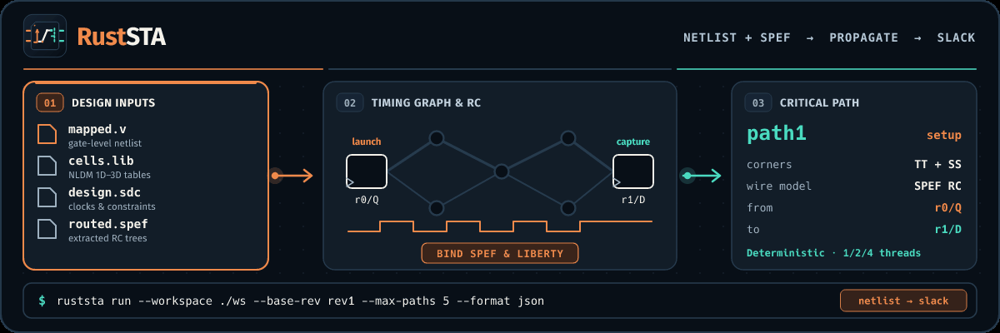

<p align="center">
  
</p>

<p align="center">
  <strong>Clean-room, deterministic multi-corner static timing analysis in Rust.</strong><br>
  <a href="https://lab-emi.github.io/RustEDA/modules/ruststa/">Documentation</a> ·
  <a href="https://github.com/lab-emi/RustEDA">RustEDA Suite</a> ·
  <a href="https://lab-emi.github.io/RustEDA/benchmarks/">Benchmarks</a> ·
  <a href="docs/development-status.md">Development Status</a> ·
  <a href="LICENSE">Apache-2.0</a>
</p>

<picture>
  <source media="(prefers-reduced-motion: reduce)" srcset="docs/assets/ruststa-banner.svg">
  
</picture>

## Why RustSTA

RustSTA delivers **sub-picosecond OpenSTA parity** at **2× the speed and lower peak RAM**, with deterministic multi-thread execution, bounded top-K path extraction, and zero-daemon disk workspaces shared natively across the RustEDA suite.

| Benchmark (same netlist, Liberty, SDC & SPEF) | RustSTA | OpenSTA 3.1.0 | RustSTA delta |
| --- | ---: | ---: | --- |
| **TT + SS timing wall time** (Ibex, 4 threads / 2 threads) | **2.82 s / 3.91 s** | 5.47 s / 6.08 s | **1.94–2.0× faster** (1.6× at 2T) |
| **Worst peak RSS** (4 threads / 2 threads) | **150.5 MiB / 121.2 MiB** | 172.2 MiB / 172.0 MiB | **-12.6% / -29.5% less RAM** |
| **Same-SPEF OpenSTA parity** (8 TT/SS worst slacks) | **≤ 0.270 ps max Δ** | Reference | **Pass (< 1 ps gate)** |
| **Dual-PDK parity suite** (332 values, SKY130 / GF180) | **0.036 ps / 0.049 ps** | Reference | **Bit-exact 1/2/8-thread replay** |
| **In-flow static timing stage** (Ibex SG13G2) | **26.96 s** | 138.93 s (LibreLane) | **5.2× faster** |

Detailed receipts live in [RustEDA Benchmarks](https://lab-emi.github.io/RustEDA/benchmarks/) (`ibex-host-20261113-followup/summary.json`, `ibex-sg13g2-ez130-host-20261113.json`).

## Core Capabilities

- **True NLDM + SPEF RC waveform analysis**: 1D–3D Liberty lookup tables, mixed standard-cell + SRAM macro timing, explicit early/late derates, driving-cell waveforms, Elmore/effective-capacitance (`f64`) charge fitting, and propagated clocks.
- **Deterministic parallel timing graph**: Contiguous SoA/CSR compute buffers (`rusteda-compute`) with level-parallel Rayon execution and deterministic topological tie-breaking — bit-identical timing tables across thread counts and full-vs-incremental updates.
- **Hard algorithmic bounds**: Topological DP (`O(V + E)`) + heap-bounded top-K path extraction (`--max-paths`, `--max-expansions`) with cycle/SCC detection; never materializes exponential path lists.
- **Agent-ready CLI**: Shared mmap workspace (`--workspace`, `--base-rev`), shell-safe handles (`path1`, `rev3`), explicit scope fields (`corner`, `wire_model`, `unconstrained_endpoints`), and `rusteda.v1` JSON output.

## Quick Start

```console,lab
$ git clone https://github.com/lab-emi/RustSTA.git
$ cd RustSTA
$ cargo build --locked --release -p rusteda-cli -p ruststa-cli
```

Confirm the built CLI (`export PATH="$PWD/target/release:$PATH"`):

```console
$ ruststa --version
ruststa 0.4.3 (backends: cpu)
```

Analyze the bundled eight-cell fixture in a fresh revisioned workspace (`rev0 → rev1 → rev2 → rev3`):

```bash
FIX=verification/fixtures/synthetic/sta
WS=.work/first-timing

rusteda init --workspace "$WS" --format json
rusteda import --workspace "$WS" --base-rev rev0 \
  --lib "$FIX/lib/wt_15.lib" \
  --netlist "$FIX/net/chain_8.v" \
  --sdc "$FIX/sdc/chain_8.sdc" --format json
ruststa run --workspace "$WS" --base-rev rev1 \
  --threads 2 --max-paths 5 --max-state-gib 1 --format json
ruststa report --workspace "$WS" --rev rev2 --section summary --format json
ruststa path --workspace "$WS" --rev rev2 --target path1 --format json
ruststa check --workspace "$WS" --base-rev rev2 --method both --format json
```

See [Quickstart](docs/guide/quickstart.md), [CLI Reference](docs/reference/cli.md), and [SPEF & RC Waveforms](docs/guide/spef.md).

## Scope & Current Limits

- **Unsupported timing features**: Generated clocks, CPPR, CCS/ECSM current-source models, crosstalk/SI, and full GF180 latch / extreme-resistance effective-capacitance corner cases emit explicit diagnostics rather than silent approximations.
- **GPU & Ngspice validation**: CPU `rayon` execution is the qualified baseline; optional CUDA/Ngspice cross-check paths remain separate experimental tracks.
- **Historical records**: Archived host campaigns and allocator RSS root-cause analyses are documented in [Development Status](docs/development-status.md) and [RustEDA Benchmarks](https://lab-emi.github.io/RustEDA/benchmarks/).

## License

Apache-2.0 — see [LICENSE](LICENSE).
