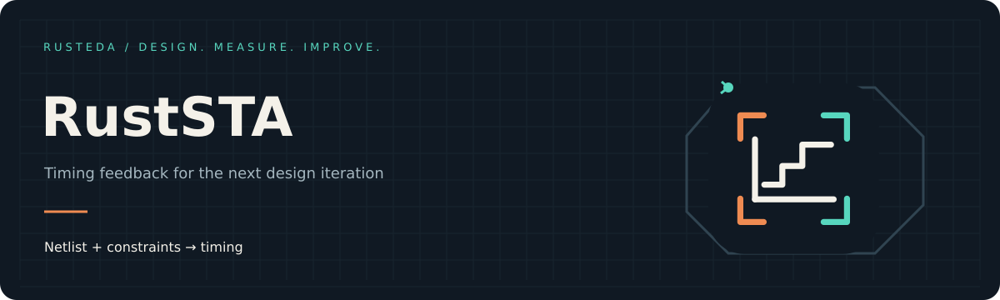

<!-- SPDX-License-Identifier: Apache-2.0 -->
<!-- SPDX-FileCopyrightText: 2026 RustSTA contributors -->

# RustEDA visual identity

RustSTA extends the **Signal Forge** identity introduced by
[RustSys](https://lab-emi.github.io/RustSys/brand/). A shared terminal/chip frame,
dark ink, copper inputs and teal outputs connect the RustEDA tools. The center
glyph identifies the tool.


## One family, distinct tools

| Tool | Center glyph | Meaning |
|---|---|---|
| RustEDA | Crossing signals and a shared node | Tools connected through explicit artifacts |
| RustSys | Logic gate | RTL becomes standard cells |
| RustSTA | Clock face with signal terminals | Netlists become timing insight |

Keep the frame, proportions and signal colors when extending the family. Use the
square mark at small sizes and the wordmark for README or document headings.
Preserve the dark tile so the artwork remains legible on light and dark pages.


## Palette and typography

| Role | Color |
|---|---|
| Ink | `#101923` |
| Copper input | `#EF8B52` |
| Teal output / active path | `#57D6BE` |
| Warm paper | `#F4F1E9` |
| Muted text | `#A1B0BA` |
| Panel | `#17242F` |

SVG artwork uses DejaVu Sans and DejaVu Sans Mono with standard fallbacks.
The site uses system fonts and loads no external font service. Copper and teal
identify the diagram's input/output roles; text labels also identify those roles.

## Netlist-to-path banner



The banner follows design inputs into a small reconvergent timing graph, moves
signals along a highlighted launch-to-capture path, and identifies that path's
scope and endpoints. The clock waveform remains visible throughout the loop.

The graph and report are explanatory artwork, not a captured run, benchmark,
physical implementation, or sign-off result. The visible shell command uses
the supported CLI. Measured performance and verification verdicts belong in
evidence reports.

The documentation shows the static poster by default and selects the GIF when
motion is allowed. JavaScript enables an explicit pause/play button and responds
to changes in the reduced-motion preference. The README also supplies a static
alternative and reduced-motion source.

## Distributed assets

| Asset | Dimensions | Use |
|---|---|---|
| [ruststa-logo.svg](../assets/ruststa-logo.svg) | 256 × 256 | Tool icon |
| [ruststa-wordmark.svg](../assets/ruststa-wordmark.svg) | 760 × 176 | README and document header |
| [favicon.svg](../assets/favicon.svg) | 256 × 256 | Documentation icon |
| [ruststa-banner.svg](../assets/ruststa-banner.svg) | 1200 × 400 | Accessible static poster |
| [ruststa-banner.gif](../assets/ruststa-banner.gif) | 1200 × 400 | 84 frames, 10 fps, 8.4-second loop |
| [rusteda-logo.svg](../assets/rusteda-logo.svg) | 256 × 256 | Shared family mark |
| [rusteda-wordmark.svg](../assets/rusteda-wordmark.svg) | 760 × 176 | Shared family identity |

## Reproduce the assets

The artwork is original SVG geometry, using the Apache-2.0 RustSys family frame
and rendering approach. There is no reference-tool source, copied competitor
logo or generated photographic asset. Python, CairoSVG and Pillow are
documentation authoring tools; they are not RustSTA runtime dependencies.

From the repository root, with DejaVu fonts installed:

```bash
free -h
python3 -m venv .work/brand-venv
.work/brand-venv/bin/python -m pip install -r docs/brand/requirements.txt
mkdir -p .work/brand
(
  ulimit -v 1048576
  /usr/bin/time -v -o .work/brand/render.time timeout 180s \
    .work/brand-venv/bin/python docs/_tools/generate_brand.py
)
```

The renderer caps the canvas at 480,000 pixels, frames at 96 and GIF output at
1 MiB. The current animation uses about 38.5 MiB for indexed frames; including
rendering and quantization scratch, estimated peak RSS is below 256 MiB.
The launch render measured about **155 MiB peak RSS**, **4.1 seconds**, and
**139 KiB GIF output**. These are authoring costs, not timing-engine benchmarks.

QA previews, a four-frame contact sheet and a SHA-256 asset manifest are written
under `.work/brand/`. `--static-only` skips raster animation rendering. Font and
render-library versions can affect raster bytes; pinned authoring dependencies
are in `docs/brand/requirements.txt`.
