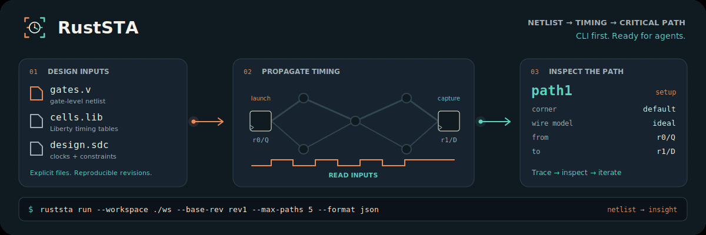

# RustSTA

RustSTA analyzes gate-level Verilog, Liberty, SDC and SPEF with persistent multi-corner timing results, bounded queries and incremental updates.

[All RustEDA modules](https://lab-emi.github.io/RustEDA/)

<picture>
  <source media="(prefers-reduced-motion: reduce)" srcset="assets/ruststa-banner.svg">
  
</picture>

## Ibex host campaign · 2026-11-02

In the RustEDA Ibex host campaign (IHP SG13G2 / EZ130 with two real SRAMs, on a
4-vCPU cloud host), RustSTA 0.4.3 and OpenSTA 3.1.0 analysed the same final
netlist, SPEF, Liberty and SDC at TT and SS. **Numerical agreement `failed` the
1 ps gate**: TT setup worst slack differs by 1.4052 ps on the native SPEF and
1.2838 ps on the OpenRCX SPEF; the other six compared values are within
0.2153 ps. The shared timing gate, which keeps the worse of the two engines'
values on the OpenRCX SPEF, `passed` at TT and SS with zero setup, hold, slew,
capacitance and fanout violations.

On the native SPEF, RustSTA's complete pipeline (init, import, one run covering
both corners, eight reports) took a median 17.898 s at 2 threads and 15.976 s at
4 threads. OpenSTA's two per-corner processes took 15.253 s and 13.497 s. Worst
peak RSS was 498,004 and 502,876 KiB against 266,916 and 267,704 KiB. **OpenSTA
was faster and used less memory on this host.** Wall time sums each
contender's processes and is the median of three interleaved measured
repetitions after one warm-up; peak RSS is the largest single process, worst of
the three. This is one task on one host.

[Scope, all eight compared values and method](development-status.md) ·
[STA head-to-head](https://lab-emi.github.io/RustEDA/benchmarks/#ruststa-vs-opensta) ·
[All benchmarks](https://lab-emi.github.io/RustEDA/benchmarks/)

## Development update · 2026-11-01

The source now includes mixed standard-cell/SRAM Liberty conventions, explicit
global early/late timing derates and driving-cell waveforms on extracted and
propagated-clock paths. RC preparation runs independent nodes within each graph
level on a bounded rayon pool, then commits results in topological order. The
memory estimate includes an additional 184 bytes per node for jobs/results.

[Source, evidence and remaining limits](development-status.md)


## Development status · 2026-10-28

**RustSTA 0.4.3** adds non-tree extracted RC networks to the integrated timing
flow. SPEF import, effective-capacitance waveforms and propagated primary clocks
are supported. Dual-PDK reference/circuit checks accompany full/incremental and
CPU/CUDA consistency checks. Mixed-library SRAM timing and global derates remain
experimental work outside this snapshot.

[Progress, measured agreement and known residuals →](development-status.md)

## Analyze. Trace. Iterate.

Run multi-corner static timing analysis, keep the result as an immutable revision,
then inspect the paths and endpoints that need attention. Queries read the
memory-mapped timing store without rerunning propagation.

```bash
ruststa run --workspace ./ws --base-rev rev1 --max-paths 5 --format json
ruststa report --workspace ./ws --rev rev2 --section summary --format json
ruststa path --workspace ./ws --rev rev2 --target path1 --format json
```

Start with the [bundled design](guide/quickstart.md) or
[import your own netlist](guide/timing.md).

## A CLI you can compose

<div class="grid cards" markdown>

- **Follow the critical path.**

    ---

    Analyze setup, hold, recovery, removal, latches and clock gating.
    Trace a path, inspect a pin, or filter endpoint reports.

    [Timing workflow →](guide/timing.md)

- **Give agents a contract.**

    ---

    JSON on stdout, coded diagnostics on stderr, shell-safe handles,
    and explicit revision guards for every update to an existing workspace.

    [Agent integration →](guide/agents.md)

- **Keep the computation predictable.**

    ---

    Deterministic CPU reference propagation in f64. Optional native CUDA.
    Explicit path and propagation-state budgets.

    [Backends and precision →](guide/backends.md)

- **Inspect the evidence.**

    ---

    Separate checker and full rerun modes, analytic fixtures, incremental
    consistency checks, and pinned Sky130 and GF180 libraries.

    [Verification scope →](verification/index.md)

</div>

## From source to a timing report

| Step | Input | Result |
|---|---|---|
| Import | Structural Verilog, Liberty, SDC | A design revision with compiled input tables |
| Analyze | An explicit base revision and operating corners | `sta.rbin`, summary and ranked paths |
| Inspect | A revision, path handle or endpoint filter | JSON or text reports without another analysis |
| Check | The stored result and a verification method | `sta_check.json` with explicit status and diagnostics |

The default CPU build needs no GPU or Python runtime. The
[quickstart](guide/quickstart.md) uses checked-in synthetic inputs and shows the
complete import → analysis → report → check flow.

## Choose your path

| I want to… | Start here |
|---|---|
| Build the tools and analyze a small design | [Installation](guide/installation.md) → [quickstart](guide/quickstart.md) |
| Analyze my own netlist across corners | [Timing workflow](guide/timing.md) → [supported scope](reference/scope.md) |
| Drive timing from an agent or CI | [Agent guide](guide/agents.md) → [CLI](reference/cli.md) → [reports](reference/reports.md) |
| Assess correctness and verification limits | [Checking](guide/checking.md) → [evidence](verification/index.md) |
| Measure runtime or choose CPU/CUDA | [Performance](guide/performance.md) → [backends](guide/backends.md) |
| Contribute to RustSTA | [Architecture](architecture/index.md) → [contributing](contributing.md) |

!!! note "Analysis scope"
    RustSTA 0.4.3 is a source preview. It supports ideal and explicitly propagated
    primary clocks, ideal/lumped wires and detailed SPEF RC networks. Generated
    clocks, CPPR, CCS and crosstalk remain outside scope. The independent checker
    returns `undecided` for extracted RC; full recomputation checks consistency.
    Check the [support table](reference/scope.md) before interpreting a result.

Part of the [RustEDA tool family](https://github.com/lab-emi).
Use [RustSys](https://lab-emi.github.io/RustEDA/modules/rustsys/) to synthesize RTL to standard cells,
then analyze the exported structural netlist with RustSTA.
