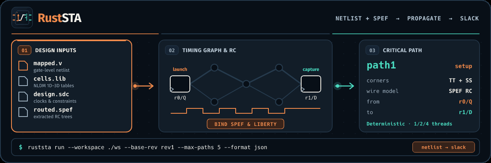

# RustSTA

Clean-room, deterministic multi-corner static timing analysis with sub-picosecond OpenSTA parity, bounded path extraction, and shared memory-mapped workspaces.

[All RustEDA modules](https://lab-emi.github.io/RustEDA/) · [Benchmarks](https://lab-emi.github.io/RustEDA/benchmarks/) · [Development status](development-status.md)

<picture>
  <source media="(prefers-reduced-motion: reduce)" srcset="assets/ruststa-banner.svg">
  
</picture>

## Highlights

| Benchmark (receipt-backed) | RustSTA | OpenSTA 3.1.0 | Delta |
| --- | ---: | ---: | --- |
| **TT + SS timing wall time** (Ibex, 4T / 2T) | **2.82 s / 3.91 s** | 5.47 s / 6.08 s | **1.94–2.0× faster** |
| **Worst peak RSS** (4T / 2T) | **150.5 MiB / 121.2 MiB** | 172.2 MiB / 172.0 MiB | **-12.6% / -29.5% RAM** |
| **Same-SPEF OpenSTA parity** (Ibex TT + SS) | **≤ 0.270 ps max Δ** | Reference | **Pass (< 1 ps gate)** |
| **Dual-PDK suite** (332 values, SKY130 / GF180) | **0.036 / 0.049 ps** | Reference | **Bit-exact 1/2/8T replay** |

## Guides & Reference

- **Get started**: [Installation](guide/installation.md) · [Quickstart](guide/quickstart.md) · [Timing](guide/timing.md) · [SPEF](guide/spef.md) · [AI Agents](guide/agents.md)
- **Verification**: [OpenSTA checks](guide/checking.md) · [RC waveforms](verification/rc-waveforms.md) · [Dual-PDK suite](verification/pdk.md) · [Requirements](verification/requirements.md)
- **Reference**: [CLI](reference/cli.md) · [Reports](reference/reports.md) · [Scope](reference/scope.md) · [Architecture](architecture/index.md)

## Known Limits

- Generated clocks, CPPR, CCS/ECSM, and crosstalk remain outside current supported flow scope and emit explicit diagnostics.
- Historical campaigns and memory/RSS follow-ups are preserved in [Development status](development-status.md) and [RustEDA Benchmarks](https://lab-emi.github.io/RustEDA/benchmarks/).
